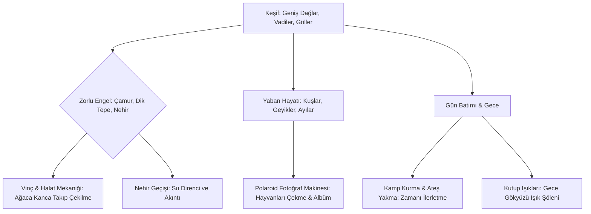

# Over the Hill (OtH) — REA Analiz Raporu & Sistem Mimarisi

Bu doküman, **REA (Reverse Engineer Anything)** tersine mühendislik araçları, Unity IL2CPP ikili dosya analizleri (`GameAssembly.dll`, `global-metadata.dat` v31, `ScriptingAssemblies.json`, `boot.config`) ve Funselektor'ün özel motor mimarisi incelenerek hazırlanmıştır.

---

## 1. REA İkili Dosya Kanıtları ve Teknik Kimlik

* **Geliştirici:** Funselektor Labs Inc. (*art of rally* ve *Absolute Drift*'in dünyaca ünlü bağımsız geliştiricisi Dune Casu).
* **Hedef Dizin:** `C:\Program Files (x86)\Steam\steamapps\common\over the hill`
* **Motor & Derleme:** Unity 6 (URP 17.x tabanlı) / **IL2CPP (Intermediate Language to C++)** 64-bit Windows Binary (`GameAssembly.dll` ~124 MB, `UnityPlayer.dll` ~34 MB).
* **Metadata İncelemesi (`global-metadata.dat`):**
  * Versiyon: **IL2CPP v31** (Magic: `0xFAB11BAF`).
  * Toplam Tip (Class/Struct) Sayısı: **28.224** adet tanımlı tip.
  * Toplam String Literal Tablosu: **193.582** adet benzersiz tanımlayıcı.
  * Bağımsız Derleme Sayısı: **178** adet entegre assembly (`Assembly-CSharp`, `FunCore`, `Cozy`, `MicroVerse`, `StylizedWater3`, `Obi`, `Fusion`, `FMODUnity` vb.).

---

## 2. Oyunun Çekirdek Konsepti ve Oynanış Döngüsü

*Over the Hill*, doğanın kalbinde geçen, huzurlu ancak zorlu bir **vahşi doğa keşif ve arazi sürüşü (overlanding / expedition)** oyunudur.

1. **Keşif ve Arazi Sürüşü:** Oyuncu, özelleştirilebilir arazi araçlarıyla yol olmayan dağlarda, ormanlarda ve nehir yataklarında ilerler.
2. **Fizik Tabanlı Kurtarma (Winch & Obi Rope):** Çamura saplanıldığında veya dik uçurumlara tırmanırken vinç kablosu bir ağaca veya kayaya bağlanır; gerçek zamanlı halat gerilimi simülasyonu ile araç yukarı çekilir.
3. **Yaban Hayatı ve Polaroid Fotoğrafçılığı:** Huzurlu doğada saklanan hayvanlar tespit edilir; Polaroid fotoğraf vizörü açılarak kare yakalanır ve fiziksel fotoğraf kartı albüme eklenir.
4. **Kamp ve Dinlenme:** Akşam olduğunda kamp kurulur (`ActiveCampfire`), ateş yakılır, çadır açılır ve gece kutup ışıkları (`AuroraTonight`) altında dinlenilir.

---

## 3. Kullanılan Üst Düzey Teknoloji ve Kütüphane Yığını

REA analizimiz, oyunun görsel mükemmelliğini oluşturan endüstri standardı özel paketleri ortaya çıkarmıştır:

| Kategori | Paket / Teknoloji | Görevi ve Oyundaki Yeri |
|---|---|---|
| **Render Hattı** | Unity URP + GPU-Driven | Yüksek kare hızında modern gölgelendirici ve GPU çekim hattı |
| **Görsel Stil** | Tilt-Shift + HBAO + Blob Shadows | Minyatür/diorama derinlik hissi, yumuşak temas gölgeleri |
| **Atmosfer & Gökyüzü** | **COZY: Weather 3** (Distant Lands) | Prosedürel 24 saatlik gün döngüsü, stilize bulutlar, iklimler |
| **Hacimsel Sis** | **Buto** (OccaSoftware) | Dağ vadilerini dolduran sinematik hacimsel sis ve ışık huzmeleri |
| **Kutup Işıkları** | Custom Aurora Scattering | Gece gökyüzünde dinamik yeşil/mor kutup ışığı parıltıları |
| **Arazi (Terrain)** | **MicroVerse & MicroSplat** (Jason Booth) | Tahribatsız prosedürel biyomlar, yüksek performanslı zemin dokulaması |
| **Bitki Örtüsü** | **The Visual Engine (TVE)** + Impostors | Rüzgârla dalgalanan ve araçla ezilen stilize ormanlar ve çimenler |
| **Su ve Nehirler** | **Stylized Water 3 & River** (Staggart) | Gerstner dalgaları, köpük, nehir akıntıları, kıyı derinliği |
| **Halat ve Fizik** | **Obi Rope** | Vinç kablolarının gerilmesi, kopması, ağaçlara dolanması |
| **Ağ / Çok Oyunculu** | **Photon Fusion** | Tahmin tabanlı (client prediction) araç senkronizasyonu |
| **Ses Motoru** | **FMOD Studio** | Doğal ortam sesleri, lo-fi müzik, dinamik motor ve lastik sesleri |

---

## 4. Dokümantasyon Modülleri

1. [01_TARZ_TEMA_VE_GORSEL_DIL.md](01_TARZ_TEMA_VE_GORSEL_DIL.md) *(En Kritik Bölüm: Sanat Tarzı, Renk Teorisi, Diorama Estetiği)*
2. [02_RENDER_GOLGELER_VE_POST_PROCESSING.md](02_RENDER_GOLGELER_VE_POST_PROCESSING.md) *(URP, HBAO, Blob Shadows, DoF)*
3. [03_ATMOSFER_HAVA_DURUMU_VE_ISIKLANDIRMA.md](03_ATMOSFER_HAVA_DURUMU_VE_ISIKLANDIRMA.md) *(COZY Weather, Buto Fog, Aurora Borealis, Kamp Ateşi)*
4. [04_ARAZI_VEGETASYON_VE_DOGAL_CEVRE.md](04_ARAZI_VEGETASYON_VE_DOGAL_CEVRE.md) *(MicroVerse, MicroSplat, TVE rüzgârı, GPU Instancer)*
5. [05_SU_VE_NEHIR_SISTEMI.md](05_SU_VE_NEHIR_SISTEMI.md) *(Stylized Water 3, nehir geçişleri, su direnci)*
6. [06_ARAC_FIZIGI_VINC_VE_HALAT_MEKANIGI.md](06_ARAC_FIZIGI_VINC_VE_HALAT_MEKANIGI.md) *(VehicleBase süspansiyonu, Obi Rope vinç fiziği)*
7. [07_YABAN_HAYATI_VE_POLAROID_FOTOGRAF_SISTEMI.md](07_YABAN_HAYATI_VE_POLAROID_FOTOGRAF_SISTEMI.md) *(Hayvan yapay zekâsı, Polaroid vizörü, fotoğraf albümü)*
8. [08_JUST_SAIL_ICIN_ILHAM_VE_UYARLAMA_STRATEJISI.md](08_JUST_SAIL_ICIN_ILHAM_VE_UYARLAMA_STRATEJISI.md) *(Bu tekniklerin Just Sail'e uyarlanması)*
