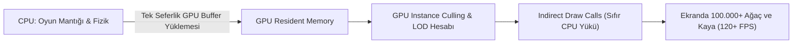

# Over the Hill — Render Hattı, Gölgeler ve Post-Processing

*Over the Hill*, Unity URP (Universal Render Pipeline) altyapısını en gelişmiş gölge, ortam karartma ve post-processing teknikleriyle birleştirerek hem 120+ FPS performans hem de kusursuz bir stilize görsel kalite elde eder.

---

## 1. Render Hattı: URP ve GPU-Driven Çizim

REA analizinde tespit edilen `Unity.RenderPipelines.GPUDriven.Runtime.dll`, oyunun Unity 6'nın en ileri grafik özelliği olan **GPU-Driven Rendering (GPU Resident Drawer)** kullandığını kanıtlamaktadır.



* **Avantajı:** Sahnedeki on binlerce ağaç, kaya, çimen ve çit parçası her kare CPU tarafından tek tek taranmaz. Veriler doğrudan ekran kartı VRAM'inde tutulur ve çizim çağrıları GPU içinde çözülür.

---

## 2. Gölgelendirme Mimarisi: "Blob Shadow" ve HBAO Uyumu

Oyunda gölgeler 3 katmanlı hibrit bir mimariyle oluşturulur:

### 2.1 Stilize Damla Gölgeler (`BlobShadow.dll`)
Araçların ve karakterlerin altında yönlü güneş gölgesine ek olarak özel bir **Blob Shadow (Yumuşak Damla Gölge)** çalışır:
* **Neden Kullanılır?** Düşük poligonlu arazilerde sert kaskad gölgeleri lastiklerin zeminle temasını koparabilir (peter-panning / floating vehicle hissi).
* **Çözüm:** Aracın tam altına zemine projekte edilen, kenarları ipeksi yumuşaklıkta degrade bir elips gölgesi yerleştirilir. Bu gölge, araç zıpladığında mesafeye göre solar; araç yere oturduğunda ise koyulaşarak güçlü bir "zemine basma" hissi verir.

### 2.2 Ufuk Tabanlı Ortam Karartması (HBAO - `HBAO.Universal.Runtime.dll`)
Standart SSAO yerine endüstri standardı **HBAO (Horizon Based Ambient Occlusion)** tercih edilmiştir:
* Araçların çamurluk içleri, süspansiyon yayları, şasi altı ve kayaların araziyle buluştuğu dipler zengin, derin temas gölgeleri kazanır.
* HBAO, nesnelerin havada asılı gibi görünmesini tamamen engeller.

### 2.3 Kaskad Güneş Gölgeleri ve Kamp Ateşi Gölgeleri
* Güneş için 4 kaskadlı CSM kullanılır.
* Gece yakılan kamp ateşleri (`ActiveCampfire`) dinamik nokta ışığı (Point Light) gölgesi yayarak çevredeki ağaçların ve çadırların arkasına titreyen, organik gölgeler düşürür.

---

## 3. Post-Processing Zinciri (Son İşlem Katmanı)

*Over the Hill*'in masalsı diorama atmosferi şu post-processing adımlarıyla mühürlenir:

```
[HAM SAHNE RENDERİ]
       │
       ├──> 1. HBAO: Köşelerde ve zemin temaslarında derinlik
       │
       ├──> 2. Tilt-Shift Depth of Field: Minyatür odak bulanıklığı
       │
       ├──> 3. Bloom & Diffusion: Güneş, su yansımaları ve ateş parıltısı
       │
       ├──> 4. Tonemapping (ACES / Neutral): Analog film kontrastı
       │
       ├──> 5. Color Grading (Split Toning): Mavi gölgeler, amber aydınlıklar
       │
       ├──> 6. Vignette & Film Grain: Nostaljik analog fotoğraf dokusu
       │
       └──> [NİHAİ EKRAN GÖRÜNTÜSÜ]
```

### 3.1 Buzlu Cam Arayüz Gölgelendiricisi (`LeTai.TranslucentImage`)
Oyun duraklatıldığında veya menüler açıldığında, arka plandaki oyun görüntüsü gerçek zamanlı çift yönlü Gauss bulanıklığı ile **buzlu cam (frosted glass)** efekti kazanır; bu da minimalist pastel UI kartlarının manzarayla uyum içinde parlamasını sağlar.

---

## 4. Görüntü Yükseltme ve Kenar Yumuşatma (DLSS, FSR3, SGSR2)

İkili dosyalarda tespit edilen `TND.Upscaling.Framework`:
* **DLSS 4 / FSR 3 / SGSR 2:** Düşük çözünürlükten (örn. 1080p) 4K'ya yapay zekâ destekli zamansal yükseltme sağlar.
* Bu sayede stilize geometrilerin kenarlarındaki tırtıklanmalar (aliasing) tamamen sıfırlanır ve resim gibi pürüzsüz çizgiler elde edilir.
