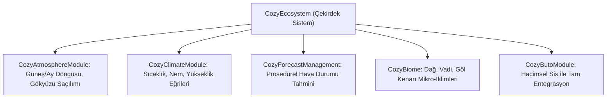
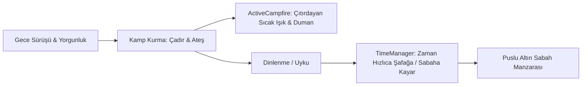

# Over the Hill — Atmosfer, Hava Durumu ve Işıklandırma Mimarisi

*Over the Hill*'in duygusal atmosferi, vahşi doğanın sakinliğini ve sertliğini aynı anda hissettirir. REA incelememizde bu atmosferin arkasında dünyanın en saygın stilize gökyüzü motoru olan **COZY: Weather 3** ve sinematik hacimsel sis motoru **Buto**'nun yer aldığı tespit edilmiştir.

---

## 1. COZY: Weather 3 Ekosistemi (`DistantLands.Cozy.Runtime.dll`)

Oyun, hazır statik gökyüzü küreleri yerine modüler bir hava durumu ekosistemi çalıştırır:



### 1.1 Prosedürel Gün Döngüsü ve Renk Geçişleri
* **Güneş Yörüngesi:** Gerçek coğrafi enlemlere göre eğik bir açıyla doğar ve batar; böylece uzun, dramatik gölgeler üretilir.
* **Şafak ve Alacakaranlık:** Güneş ufuk çizgisine yaklaşırken atmosferik ışık eğrileri gökyüzünü pastel leylak, şeftali ve kayısı tonlarına boyar.
* **Yıldızlı Gece ve Ay Evreleri:** Geceleri gökyüzü derin bir laciverte döner; ay ışığı soğuk zümrüt ve gümüş yansımalar yayar.

---

## 2. Buto: Vadileri Dolduran Hacimsel Sis (`OccaSoftware.Buto.Runtime.dll`)

*Over the Hill*'in kartpostalları andıran dağ manzaralarının anahtarı **Buto Volumetric Fog** sistemidir:

### 2.1 Yüksekliğe Bağlı Sis Dağılımı (Height-based Falloff)
* Sis haritanın her yerine homojen dağılmaz; ağırlığıyla vadilere, dere yataklarına ve göl çukurlarına çöker.
* Oyuncu tepeye tırmandığında (`Over the Hill`), sis bulutunun üstüne çıkar; ayaklarının altında pamuk gibi bir sis denizi uzanırken tepeler pırıl pırıl güneşle yıkanır.

### 2.2 Ağaç Aralarından Sızan Işık Huzmeleri (Volumetric God Rays)
* `ButoLight` bileşenleri, güneş ışığının çam ağaçlarının dalları arasından ve kaya yarıklarından süzülerek ekranda görünür altın rengi ışık demetleri (crepuscular rays) oluşturmasını sağlar.

---

## 3. Büyülü Kutup Işıkları: Aurora Borealis Sistemi

REA incelememizde ortaya çıkarılan en büyüleyici mekaniklerden biri **Kutup Işıkları** kodlarıdır:

```csharp
// REA Metadata Bulguları
TimeManager.AuroraTonight;
ApplyAuroraLightScattering();
NightAuroraChance;
Cheat_SetAurora();
```

* **Dinamik Belirme:** Her gece kutup ışığı görünmez. `NightAuroraChance` parametresine ve hava profiline (`AuroraBlockedWeatherProfiles`) göre rastgele bir ihtimalle tetiklenir.
* **Işık Saçılımı ve Yansımalar:** Kutup ışıkları gökyüzünde yeşil ve eflatun perdeler halinde dalgalanırken, `ApplyAuroraLightScattering` fonksiyonu gökyüzünden gelen ortam ışığını yeşile boyar. Bu etki dağların karlı zirvelerinde ve nehirlerin durgun sularında masalsı yansımalar oluşturur.

---

## 4. Kamp Sistemi, Ateş ve Zaman Hızlandırma

Yolda gece olduğunda oyuncu rastgele durup sabahı beklemek zorunda kalmaz; oyun **organik bir kamp mekaniği** sunar:



* **Kamp Ateşi Fiziği ve Işığı (`ActiveCampfire`, `CabinCampingFX`):** Ateş yakıldığında etrafa sıcak amber rengi bir nokta ışığı yayılır; duman partikülleri gece göğüne doğru yükselir.
* **Zaman Akışı (`TimeManager.TimeSpeed`):** Oyuncu dinlendiğinde zaman akışı kademeli olarak hızlanır; gökyüzündeki yıldızların dönüşü ve şafağın söküşü hızlandırılmış bir çekim (time-lapse) gibi akarak oyuncuya görsel bir ödül sunar.
