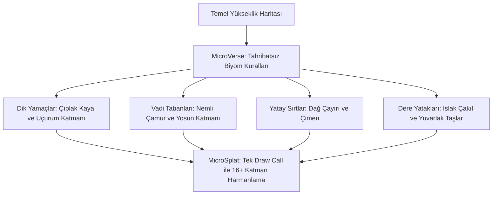

# Over the Hill — Arazi, Bitki Örtüsü ve Doğal Çevre Mimarisi

*Over the Hill*'in arazisi, uçsuz bucaksız dağ silsilelerini, sık iğne yapraklı ormanları ve kayalık nehir yataklarını tek bir kesintisiz dünyada birleştirir. Bu devasa doğal çevre, **MicroVerse, MicroSplat, The Visual Engine (TVE)** ve **Amplify Impostors** teknolojilerinin uyumuyla inşa edilmiştir.

---

## 1. Arazi Mimarisi: MicroVerse & MicroSplat (`JBooth.MicroSplat.Core.dll`)

Geleneksel elle boyanmış hantal Unity arazileri yerine, Jason Booth tarafından geliştirilen endüstri standardı modüler arazi sistemi kullanılmıştır:



### 1.1 Triplanar Uçurum Dokulaması (Esneme / Gerilme Engelleme)
* Dik dağ yamaçlarında standart UV kaplamaları dokuyu sündürür ve çirkinleştirir.
* MicroSplat, dik açılı yamaçlarda otomatik **Triplanar Projeksiyon** açarak kaya dokusunu 3 eksenden kesintisiz yansıtır.

### 1.2 Prosedürel Islaklık ve Kar Birikimi (`AccumulatedSnow`)
* Hava durumu yağmura döndüğünde vadi tabanları otomatik olarak koyulaşır ve pürüzlülüğü (roughness) düşerek ıslak çamur görünümü alır.
* Yüksek irtifalarda kış aylarında veya kar fırtınalarında `AccumulatedSnow` parametresiyle kaya tepelerine ve ağaç dallarına usulca kar birikir.

---

## 2. Canlı Bitki Örtüsü: The Visual Engine (TVE) (`Boxophobic.TheVisualEngine.Runtime.dll`)

Oyundaki her çimen ve ağaç rüzgârla yaşayan dinamik bir organizmadır:

### 2.1 Çok Katmanlı Rüzgâr Simülasyonu
TVE gölgelendiricileri 3 kademeli rüzgâr matematiği çalıştırır:
1. **Gövde Esnemesi (Macro Sway):** Güçlü rüzgâr estiğinde koca çam ağaçları köklerinden hafifçe salınır.
2. **Dal Hareketi (Branch Motion):** Orta frekanslı dal dalgalanmaları.
3. **Yaprak Titremesi (Leaf Flutter):** Yüksek frekanslı, hafif meltemlerde bile kıpırdayan yaprak detayları.

### 2.2 Araç Etkileşimi (Grass & Bush Bending)
Araç çimenlerin veya çalıların üzerinden geçtiğinde bitkiler aracın altından ezilerek iki yana yatar; araç uzaklaştıktan sonra yavaşça eski formuna döner.

---

## 3. Devasa Ölçek ve Performans: Amplify Impostors & GPU Instancer

Haritada ufka kadar uzanan milyonlarca ağacın 120 FPS ile akıcı çalışabilmesinin arkasında iki dev teknoloji yatar:

```
[KAMERA] ──(0 - 80m: Tam 3D Ağ)──> [80 - 300m: GPU Instanced Düşük LOD] ──> [300m - 5000m+: Octahedral Impostors]
          Poligon ve Dal Fiziği       Basitleştirilmiş Geometri                 Tek Bir Düz Poligon (Sprite)
          TVE Rüzgârı & Etkileşim     GPU Instancer Pro                         Amplify Impostors (Işık Senkronu)
```

* **Amplify Impostors (`AmplifyImpostors.Runtime.dll`):**
  * Kilometrelerce uzaktaki dağların sırtlarını kaplayan on binlerce ağaç gerçek 3D model olarak çizilmez.
  * Ağacın her açıdan görünüşü önceden sekizgen bir dokuya fırınlanmıştır. Kamera döndükçe ve güneş battıkça bu düz spritelar ışığı gerçek 3D ağaç gibi yansıtır.
  * **Sonuç:** Milyonlarca poligonluk bir orman sadece birkaç düzlemle sıfır ekran kartı yüküyle çizilir.
