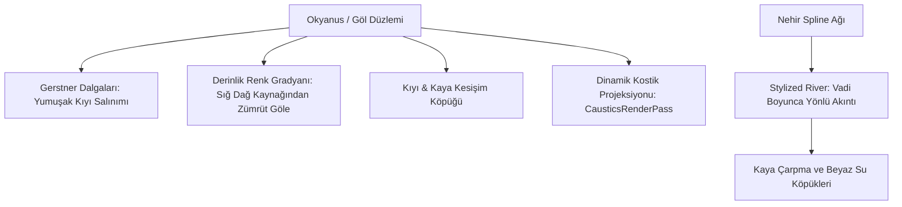

# Over the Hill — Su, Göller ve Nehir Akıntı Sistemi

*Over the Hill*'de su, sadece seyredilen bir manzara unsuru değil; araçların geçmek zorunda olduğu, akıntısıyla sürükleyen ve motoru boğma riski taşıyan aktif bir coğrafi engeldir.

Bu sistem, Staggart Creations'ın ödüllü **Stylized Water 3** ve **Stylized River** motorları üzerine kurulmuştur.

---

## 1. Stylized Water 3 Mimarisi (`sc.stylizedwater3.runtime.dll`)

Staggart Creations'ın su motoru, Funselektor'ün minimalist sanat tarzıyla kusursuz bir uyum sağlar:



### 1.1 Su Rengi ve Berraklığı (Optik Katman)
* Dağ derelerinde su neredeyse tamamen şeffaftır; dere tabanındaki yuvarlak çakıl taşları net bir şekilde görülür.
* Su derinleştikçe zengin turkuaz ve soğuk dağ zümrüdü tonlarına döner.
* Su yüzeyinde gökyüzü bulutları ve dağ siluetleri pürüzsüz bir ayna gibi yansır.

### 1.2 Kıyı ve Kaya Köpüğü (Shoreline Foam)
* Su yüzeyi bir kayayla veya çamurlu kıyıyla kesiştiğinde, derinlik farkı tamponundan (`SceneDepth - SurfaceDepth`) dinamik, yumuşak bir beyaz köpük halkası türetilir.
* Sabit bir doku kayması yerine, kıyıya vuran dalgayla birlikte nefes alıp veren organik bir köpük animasyonu oynatılır.

---

## 2. Dağ Nehirleri ve Akıntı Fiziği (`sc.modeling.river.runtime.dll`)

* Dağ vadileri boyunca kıvrılan dereler ve nehirler **Spline Modelleme** ile araziye oturtulmuştur.
* **Yönlü Akıntı Vektörü:** Nehir yüzeyindeki normal haritası ve köpük dokuları suyun yerçekimi yönünde, vadi aşağı akışını simüle eder.
* Nehrin ortasında duran büyük kayaların önünde kabaran dalgacıklar (bow wave), arkasında ise girdap ve beyaz su köpükleri (wake foam) otomatik olarak hesaplanır.

---

## 3. Araç ve Su Etkileşimi (River Forcing & Water Physics)

REA metadata analizinde tespit edilen `CarIsTouchingWater` ve `AlignToWater` fonksiyonları, suyun araç üzerindeki fiziksel etkilerini yönetir:

```csharp
// REA Metadata Bulguları
CarIsTouchingWater;
CacheWaterSurface;
AlignToWater;
```

1. **Hidrodinamik Direnç (Water Drag):**
   * Araç nehre girdiğinde suyun seviyesi lastiklerin göbeğini aştıkça doğrusal sürtünme katlanarak artar.
   * Araç yavaşlar; tekerlekler çakıllı nehir tabanında patinaj yapmaya başlar.
2. **Akıntı İtmesi (River Current Force):**
   * Hızlı akan nehirlerde suyun debisi aracı yanlamasına vadi aşağı sürüklemeye çalışır.
   * Oyuncu akıntıya karşı direksiyon kırmak ve gazı dikkatli ayarlamak zorundadır.
3. **Motor Boğulma Riski ve Vinçle Kurtarma:**
   * Su seviyesi motor kaputunun üstüne çıktığında araç stop etme tehlikesiyle karşı karşıya kalır.
   * Bu noktada oyuncu aracı terk etmeden vinç sistemini (`VehicleWinchSystem`) devreye sokarak nehrin karşı kıyısındaki sağlam bir çam ağacına kanca atar ve aracı sudan çeker.
