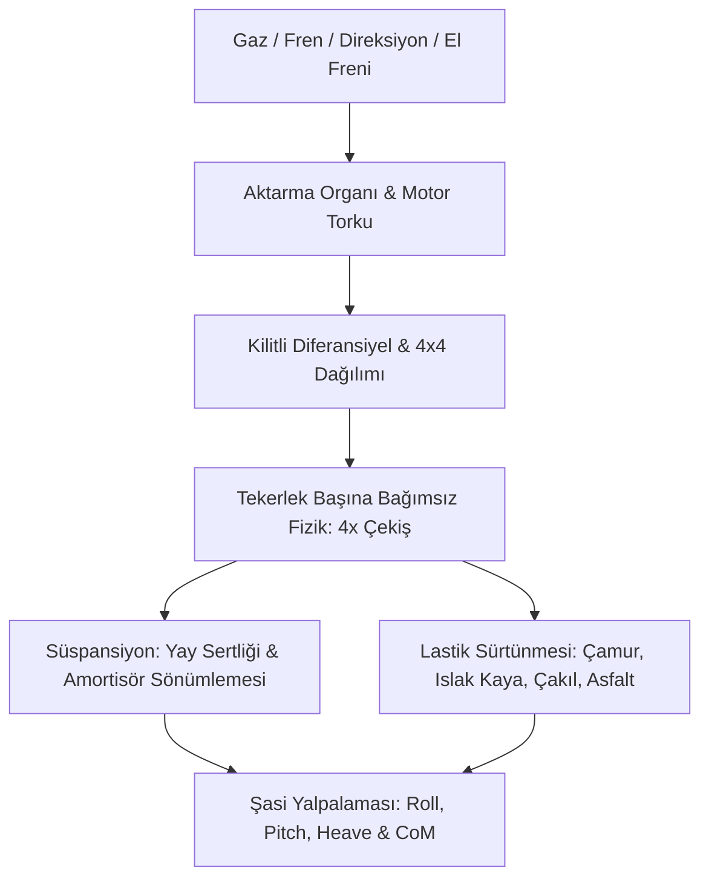
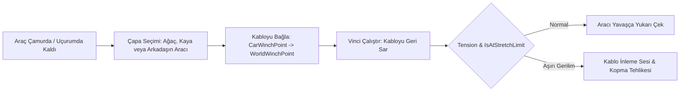

# Over the Hill — Araç Fiziği, Vinç ve Halat (Obi Rope) Mekaniği

*Over the Hill*'in sürüş hissi, Funselektor'ün önceki efsanevi oyunu *art of rally*'nin akıcı araç dinamiklerini alır; ancak bu kez yüksek hızda drift yerine **zorlu arazi şartlarında çekiş, süspansiyon esnemesi ve fizik tabanlı vinçle kurtarma** üzerine odaklar.

---

## 1. Araç Dinamiği Mimarisi (`VehicleBase`)

REA analizinde tespit edilen `VehicleBase` değişkenleri, son derece gelişmiş bir arazi fiziği çekirdeğine işaret eder:



### 1.1 Süspansiyon Artilkülasyonu (Axle Articulation)
* Kayalık zeminlerde araç ilerlerken her bir tekerlek bağımsız olarak yukarı/aşağı esner (yüksek süspansiyon mesafesi).
* Bir tekerlek havada kalsa bile diferansiyel kilidi sayesinde yere basan diğer tekerlekler aracı ileri itmeye devam eder.

### 1.2 Yüzey Bazlı Tutunma Eğrileri (Tire Traction Friction)
* **Kuru Çakıl:** Orta tutunma, kontrollü savrulma.
* **Islak Çamur:** Düşük boyuna sürtünme; lastikler hızla çamura gömülür ve patinaj başlar.
* **Büyük Kayalar:** Yüksek sürtünme, ancak lastik eğimli yüzeyde kayarsa ani devrilme riski.

---

## 2. Devrimsel Vinç ve Halat Fiziği (`VehicleWinchSystem` & Obi Rope)

Oyunu diğer tüm keşif oyunlarından ayıran en önemli mühendislik başarısı, **Obi Rope (`Obi.dll`) parçacık tabanlı fizik motoruyla entegre çalışan vinç sistemidir**.



### 2.1 REA Metadata Bulguları
İkili dosyalarda vinç sisteminin tüm durum makineleri çözülmüştür:
```csharp
VehicleWinchSystem.AttachedWinchesOwners;
VehicleWinchSystem.IsAtStretchLimit;
VehicleWinchSystem.IsSlipping;
VehicleWinchSystem.IsStalled;
VehicleWinchSystem.IsTaut;
VehicleWinchSystem.MaxRopeLength;
VehicleWinchSystem.NormalizedTension;
VehicleWinchSystem.RopeLength;
VehicleWinchSystem.Tension;
VehicleWinchSystem.WinchAnchorPoint;
VehicleWinchSystem.WinchAttachPointInCar;
VehicleWinchSystem.WinchedCarPlayerRef;
```

### 2.2 Gerçek Zamanlı Halat Simülasyonu
1. **Fiziksel Partikül Zinciri (Obi Rope):** Kablo düz bir çizgi değildir; yerçekimiyle sarkar, yerdeki kayaların etrafından dolanır ve ağaç gövdesine temas ettiğinde bükülür.
2. **Dinamik Gerilim (`Tension` & `NormalizedTension`):**
   * Vinç aracı çekerken motor zorlandıkça kablo gerilir (`IsTaut = true`).
   * FMOD ses motoru gerilim arttıkça çelik kablonun gıcırdama ve inleme seslerini dinamik olarak yükseltir.
   * Eğer gerilim azami sınırı aşarsa (`IsAtStretchLimit = true`), vinç motoru kilitlenir (`IsStalled = true`) veya kablo koparak fırlar.
3. **Çok Oyunculu Yardımlaşma (`WinchedCarPlayerRef`):**
   * Photon Fusion ağı üzerinden bir oyuncu diğer bir oyuncunun kancasına bağlanabilir.
   * Güçlü bir kamyon, uçurumdan düşmek üzere olan hafif bir jipi yukarı çekerek kurtarabilir.
