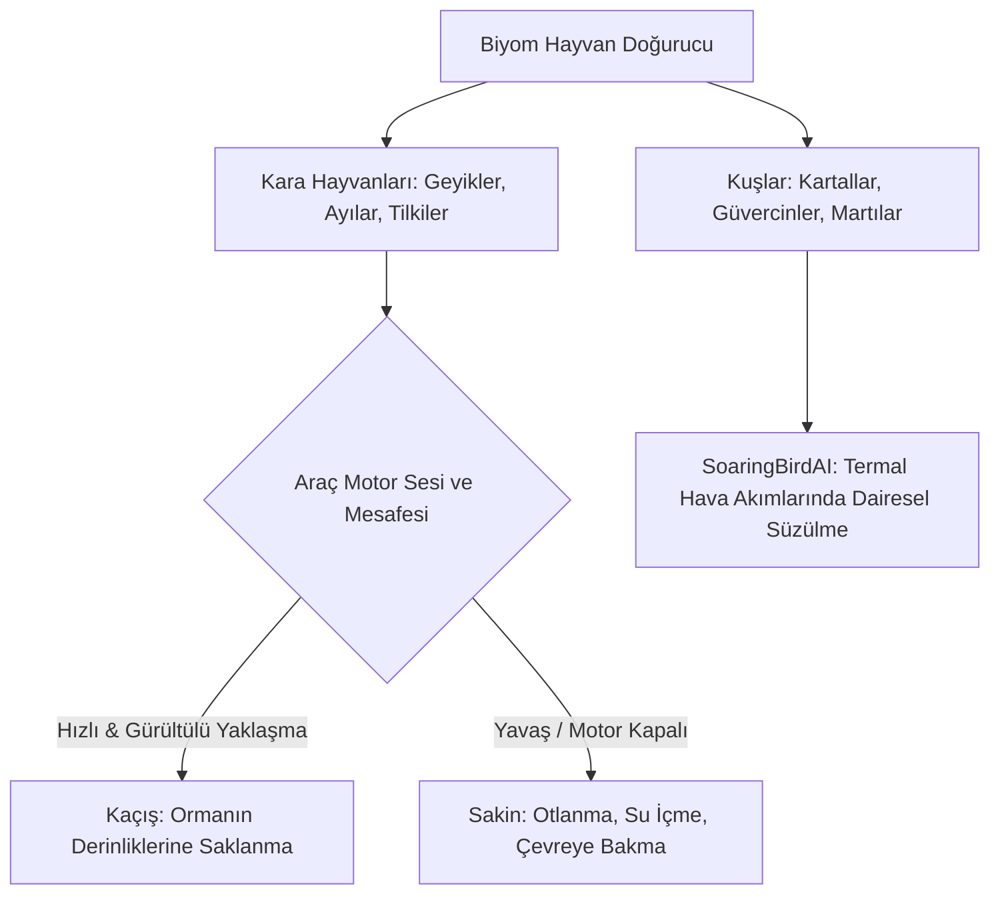
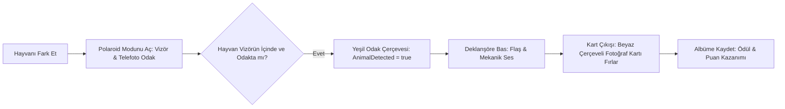

# Over the Hill — Yaban Hayatı ve Polaroid Fotoğrafçılık Sistemi

*Over the Hill*, doğayı sadece geçip gidilen bir parkur olarak görmez; oyuncuyu yavaşlamaya, motoru kapatıp çevreyi dinlemeye ve gizli yaban hayatını keşfetmeye teşvik eder.

Bu keşif hissi, **basit ama etkili hayvan yapay zekâsı** ve **fiziksel Polaroid fotoğrafçılık mekaniği** ile taçlandırılmıştır.

---

## 1. Yaban Hayatı Ekosistemi (Wildlife AI)

REA analizinde ortaya çıkarılan hayvan kontrol sınıfları:

```csharp
// REA Metadata Bulguları
AnimalAI_Simple;
AirborneAnimalProperties_Simple;
SoaringBirdAI_Simple;
PigeonAI_Simple;
AlwaysAirborneAnimalSpawner;
```



### 1.1 Süzülen Kuşlar (Soaring Bird AI)
* Dağ vadileri ve göl üzerindeki yükselen sıcak hava akımlarında (thermals) kartallar ve şahinler fiziksel kanat çırpmadan dairesel süzülüşler yapar.
* Bu kuşlar sadece dekor değildir; altlarında gizli bir gölet, kanyon veya özel bir keşif noktası olduğuna dair doğal birer pusula görevi görürler.

---

## 2. Polaroid Fotoğraf Modu (`PolaroidModeCamera`)

Bir hayvan gördüğünde oyuncu aracını durdurup **Polaroid Modu**'na geçer:



### 2.1 REA Metadata Bulguları
Fotoğraf sisteminin tüm UI ve mantık akışı metadata'da doğrulanmıştır:
```csharp
ActivatePolaroidModeCamera;
AnimalCameraScript;
AnimalsDetectionCamera;
AnimalsPhotographed;
AnimalPhotographedRewardPanel;
AnimalPolaroid;
AreaPolaroid;
EnablePolaroidModeCameraVignette;
PolaroidMaxRotation;
PolaroidPositionJitter;
```

### 2.2 Fotoğrafın Fiziksel Kart Haline Gelmesi
* Deklanşöre basıldığında ekranda anlık beyaz bir flaş patlar ve analog bir makine sesi duyulur.
* Ekrana Polaroid kartı fırlar; fotoğraf önce gri/bulanıkken saniyeler içinde kimyasal olarak belirir gibi netleşir.
* **Fotoğraf Değerlendirme:** Hayvanın büyüklüğü, kadrajdaki konumu ve ışığın kalitesine göre (örn. gün batımında çekilen altın saat fotoğrafı) ekstra puan ve keşif ödülü verilir.

---

## 3. Yolculuk Günlüğü: Polaroid Scrapbook Albümü

Çekilen tüm fotoğraflar dijital bir ızgarada değil, **gezginin kişisel not defterinde (scrapbook)** sergilenir:

* **Organik Yerleşim (`PolaroidPositionJitter`, `PolaroidMaxRotation`):** Fotoğraf kartları defterin sayfalarına mükemmel düz çizgilerle dizilmez; hafifçe sağa sola kayık, üst üste binen ve elle yapıştırılmış gibi doğal açılarla yerleşir.
* **El Yazısı Notlar:** Kartın altındaki beyaz boşluğa hayvanın türü, çekildiği yer ve saat el yazısı fontuyla not düşülür.
* Bu taktil sunum, oyuncunun yaptığı keşif yolculuğunu kişiselleştirir ve derin bir nostalji hissi yaratır.
