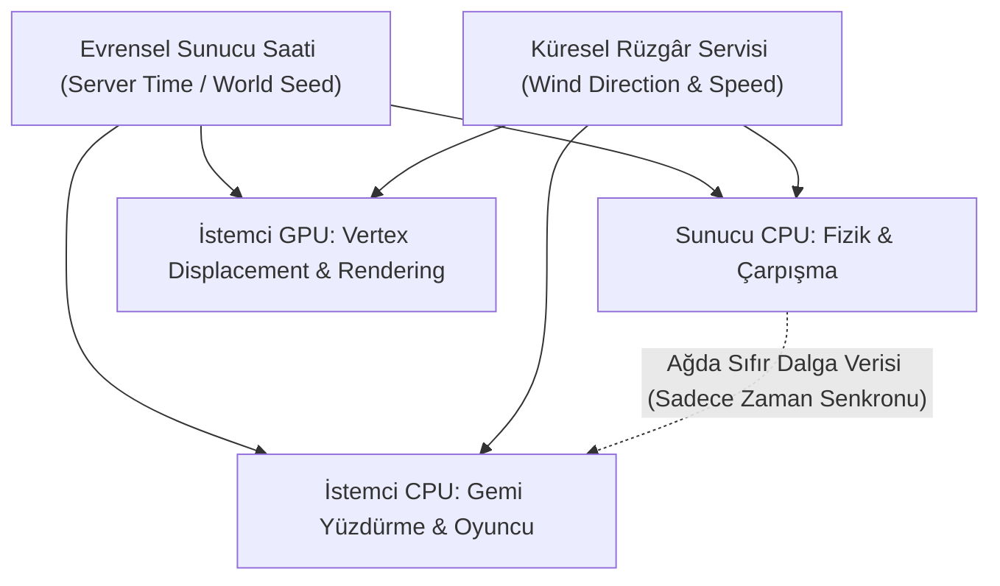

# Sea of Thieves — Tersine Mühendislik ve Sistem Mimarisi Genel Bakış

Bu doküman, **REA (Reverse Engineer Anything)** analizleri, ikili dosya incelemeleri (`SoTGame.exe`, `PSOCache`, yapılandırma dosyaları) ve Rare'in Unreal Engine 4 tabanlı özel motor mimarisi temel alınarak hazırlanmıştır.

---

## 1. REA Analiz Kanıtları ve Dosya İncelemesi

### 1.1 Yürütülebilir Dosya ve Bellek Düzeni
* **Hedef İkili Dosya:** `Athena/Binaries/Win64/SoTGame.exe`
* **Format:** PE32+ (x86_64, Windows 64-bit)
* **İç Kod Adı:** `Athena` (Rare'in Sea of Thieves için kullandığı dahili proje ve motor adı).
* **Güvenlik ve Bütünlük:** 
  * İkili dosya koruma katmanı (`.boot`, `.tms` ve şifrelenmiş bellek bölümleri) içermektedir. Disk üzerinde yaklaşık 61 MB olan çalıştırılabilir dosya, çalışma zamanında sanal bellekte ~120 MB (`VirtSize: 120,192,311`) genişletilmiş kod alanına açılmaktadır.
  * EasyAntiCheat ve bütünlük doğrulayıcılar (`Installers/EasyAntiCheat_EOS_Setup.exe`) istemci tarafı kod modifikasyonlarını engellemektedir.
* **Grafik Altyapısı:** DirectX 12 (`D3D12/d3d12core.dll`) ve DirectX 11 yedek desteği.

### 1.2 PSO Ön Belleği (Pipeline State Object Cache)
* `Athena/Config/PSOCache/Default_D3DCompute.upsoprecache` (273 KB)
* `Athena/Config/PSOCache/Default_D3DGraphics.upsoprecache` (74 MB)
* **Bulgular:**
  * DXBC (DirectX Bytecode) içeren binlerce derlenmiş gölgelendirici (shader) kaydı mevcuttur.
  * Okyanus yüzeyi simülasyonu ve tepe deformasyonu (vertex displacement) hem Compute Shader (FFT hesaplamaları ve simülasyon haritaları için) hem de Vertex/Pixel Shader aşamalarında icra edilmektedir.

### 1.3 Yapılandırma İpuçları (`ClientConfiguration.json`)
Oyunun yapılandırma dosyasında su sistemine doğrudan işaret eden kritik bir parametre tespit edilmiştir:
```json
"AggregateTick.MaxWaterHeightComponentsToUpdatePerFrame": 35
```
Bu parametre, okyanus yüzey yüksekliğini hesaplayan bileşenlerin (`WaterHeightComponent`) CPU bütçesini aşmamak adına kare başına en fazla 35 adet toplu güncellemeye tabi tutulduğunu doğrulamaktadır.

---

## 2. Sea of Thieves Motorunun Temel Tasarım Prensibi: Deterministik Senkronizasyon

Sea of Thieves'in su ve atmosfer sistemlerinin en devrimsel yönü, **ağ üzerinden dalga geometrisi veya rüzgâr verisi aktarmamasıdır**.



1. **Determinizm:** Sunucu ve tüm istemciler aynı zaman değerini (`t`) ve koordinatı `(x, y)` formüle girdiğinde milimetresine kadar aynı dalga yüksekliğini, eğimini ve yüzey normalini elde eder.
2. **Sıfır Ağ Yükü:** Okyanus için tek bir poligon veya dalga yüksekliği ağ üzerinden taşınmaz. Yalnızca hava durumu durumu (örneğin fırtına koordinatı ve rüzgâr açısı) çoğaltılır (replicated).
3. **Çift Yönlü Değerlendirme (CPU & GPU):**
   * **CPU:** Gemilerin ve oyuncuların yüzme/kaldırma kuvveti hesaplamalarında analitik matematiksel dalga fonksiyonunu çözer.
   * **GPU:** Çizim aşamasında aynı matematiksel fonksiyonu Vertex Shader içinde işleterek ekrandaki su geometrisini tam olarak CPU'nun öngördüğü yüksekliğe kaldırır.

---

## 3. Doküman Haritası

Bu analiz 5 ana modüle ayrılmıştır:

1. [01_SU_MEKANIKLERI_VE_DALGA_SIMULASYONU.md](01_SU_MEKANIKLERI_VE_DALGA_SIMULASYONU.md):
   * Gerstner & FFT dalga spektrumu, CPU-GPU matematiksel eşleşmesi, Jacobian köpük algoritması, kıyı şeridi sönümleme.
2. [02_GEMI_FIZIGI_VE_YUZDURME_BUOYANCY.md](02_GEMI_FIZIGI_VE_YUZDURME_BUOYANCY.md):
   * Prob tabanlı yüzdürme kuvveti, gövde hidrodinamiği, sintine/su alma fiziği ve alabora mekaniği.
3. [03_GOLGELENDIRME_VE_AYDINLATMA.md](03_GOLGELENDIRME_VE_AYDINLATMA.md):
   * CSM (Kademeli Gölge Haritaları), DFAO, su altı ışık huzmeleri (God Rays) ve animasyonlu kostikler.
4. [04_HAVA_DURUMU_VE_ORTAM_SISTEMI.md](04_HAVA_DURUMU_VE_ORTAM_SISTEMI.md):
   * Gezici Fırtına Aktörleri (Storm Actors), hacimsel bulutlar (Raymarched Volumetric Clouds), atmosferik saçılım ve ıslaklık shader'ları.
5. [05_JUST_SAIL_UYARLAMA_REHBERI.md](05_JUST_SAIL_UYARLAMA_REHBERI.md):
   * Bu bulguların **Just Sail** (Unity 6 / URP 17.6) projesine C# ve HLSL kodları ile adım adım entegre edilmesi.
