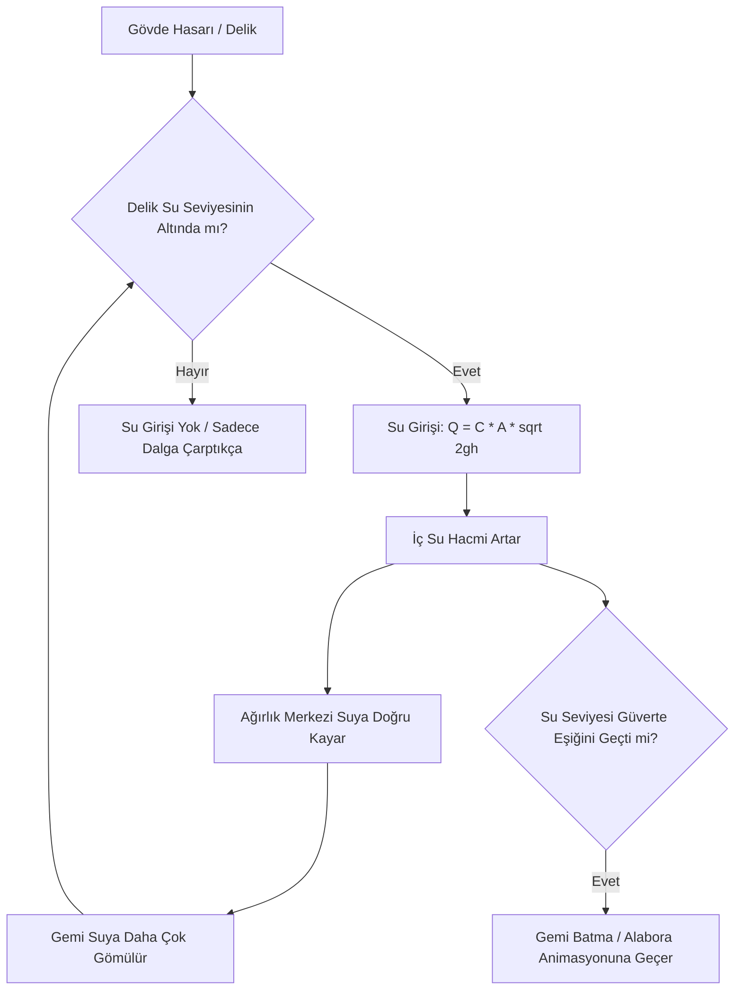

# Sea of Thieves — Gemi Fiziği, Yüzdürme (Buoyancy) ve Sintine Mekaniği

Sea of Thieves'te gemilerin dalgalarla etkileşimi, hem gerçekçi fizik prensiplerine (Archimedes kaldırma kuvveti, hidrodinamik sürtünme) hem de oyuncuyu deniz tutmasını önleyen arcade stabilizasyon hilelerine dayanır.

---

## 1. Çok Noktalı Yüzdürme Probları (Buoyancy Probes)

Bir geminin tüm 3D ağını su yüzeyiyle kesiştirmek (Mesh-Water boolean slicing) çok yüksek CPU maliyetine sahiptir. Sea of Thieves bunun yerine **akıllı fizik probları (örnekleme noktaları)** kullanır.

```
                  [BAŞ / BOW]
                    (Probe 1)
                     /     \
           (Probe 2)         (Probe 3)
           [İSKELE]          [SANCAK]
              |                 |
           (Probe 4)   (CoM) (Probe 5)  <-- Ağırlık Merkezi (Center of Mass)
              |                 |
           (Probe 6)         (Probe 7)
                     \     /
                    (Probe 8)
                  [KIÇ / STERN]
```

* **Sloop (Tek direkli küçük gemi):** ~6-8 prob.
* **Brigantine (İki direkli orta gemi):** ~10-12 prob.
* **Galleon (Üç direkli büyük kalyon):** ~14-16 prob.

Her prob, geminin yerel koordinat sisteminde sabit bir konuma (`LocalOffset`) ve temsil ettiği bir hacim katsayısına (`VolumeWeight`) sahiptir.

---

## 2. Kaldırma Kuvveti ve Tork Matematiği

Fizik motoru (PhysX) her alt adımda (fixed tick) her bir prob için şu hesaplamayı yapar:

### 2.1 Prob Batma Derinliği
```csharp
Vector3 probeWorldPos = shipTransform.TransformPoint(probe.LocalOffset);
float waterSurfaceHeight = OceanService.GetWaterHeight(probeWorldPos.x, probeWorldPos.z, currentTime);
float submergenceDepth = waterSurfaceHeight - probeWorldPos.y;
```

### 2.2 Kaldırma Kuvveti (Archimedes Prensibi)
Eğer `submergenceDepth > 0` ise (prob suyun altındaysa):

$$
F_{buoyancy} = \rho_{water} \cdot V_{probe} \cdot g \cdot \text{clamp}\left(\frac{\text{submergenceDepth}}{H_{max}}, 0, 1\right)
$$

Burada:
* $\rho_{water}$: Su yoğunluğu ($1000 \, kg/m^3$).
* $V_{probe}$: Bu noktanın taşıdığı su hacmi eşdeğeri.
* $g$: Yerçekimi sabiti ($9.81 \, m/s^2$).
* $H_{max}$: Probun tamamen batmış sayıldığı azami derinlik payı.

### 2.3 Tork ve Açısal Moment
Kuvvet, geminin ağırlık merkezine (`Center of Mass - CoM`) göre bir moment kolu oluşturur:

$$
\vec{\tau}_i = (\vec{P}_{probe} - \vec{P}_{CoM}) \times \vec{F}_{buoyancy}
$$

Tüm problardan gelen kuvvetler ve torklar toplanarak geminin Rigidbody bileşenine uygulanır:
* Baş probları suya battığında geminin burnu yukarı kalkar (Pitch).
* İskele (sol) probları battığında gemi sağa yatar (Roll).
* Dalga tepesi geminin altından geçerken gemi dikey eksende yükselir (Heave).

---

## 3. Hidrodinamik Sönümleme ve Stabilizasyon

Saf bir Archimedes hesabı yapıldığında gemi suyun üzerinde durmaksızın zıplar ve kontrolsüzce sallanır. Sea of Thieves bu sorunu **hidrodinamik sürtünme ve açısal sönümleme** ile çözer:

1. **Doğrusal Sönümleme (Linear Damping):**
   Gemi suya dikey veya yatay hareket ederken suyun direnci hıza ters yönde bir karşı kuvvet üretir:
   $$\vec{F}_{drag} = -0.5 \cdot C_d \cdot \rho \cdot A \cdot |\vec{v}_{rel}| \cdot \vec{v}_{rel}$$
2. **Açısal Sönümleme (Angular Damping):**
   Dalgaların oluşturduğu yalpalama hareketinin 2-3 salınım içinde durması için açısal hıza karşı güçlü bir tork sönümlemesi uygulanır:
   $$\vec{\tau}_{damp} = -C_{angular} \cdot \vec{\omega}$$
3. **Yatay Dalga İtmesi (Horizontal Wave Surge):**
   Gerstner dalgaları yatayda da yer değiştirme ürettiği için, dalganın tepe noktası gemiyi dalga yönünde hafifçe sürükler; gemi dalgayla birlikte sörf yapar.

---

## 4. Sintine Fiziği ve Su Alma (Ship Flooding / Bilge Water)

Sea of Thieves'in en özgün mekaniklerinden biri, geminin aldığı hasara göre dinamik olarak suyla dolması ve bu suyun fiziksel ağırlık oluşturmasıdır.



### 4.1 Deliklerden Su Giriş Hızı
Bir delikten saniyede giren su miktarı Torricelli prensibiyle hesaplanır:

$$
Q = C_{orifice} \cdot A_{hole} \cdot \sqrt{2 \cdot g \cdot h_{pressure}}
$$

* $h_{pressure}$: Deliğin dışarıdaki okyanus yüzeyinden ne kadar aşağıda olduğu. Gemi dalganın tepesine çıktığında alt kattaki delikler daha hızlı su alır; dalga çukurundayken su girişi yavaşlar.
* **Katmanlı Güverte Sistemi:** Kalyonda alt güverte (bottom deck) tamamen suyla dolmadan orta güverte (mid deck) deliklerinden su girmez. Bu sayede kalyon batmadan önce oyunculara tamir için zaman tanınır.

### 4.2 Ağırlık Merkezinin (CoM) Kayması
Gemiye dolan su sabit bir ağırlık değildir; geminin yattığı tarafa doğru akar (Sloshing):
* Eğer gemi sancak (sağ) tarafındaki deliklerden su alıyorsa, iç su sağ tarafta birikir.
* Ağırlık Merkezi sağa ve aşağıya kayar:
  $$\vec{P}_{CoM}' = \frac{M_{hull} \cdot \vec{P}_{hull} + M_{water} \cdot \vec{P}_{water\_centroid}}{M_{hull} + M_{water}}$$
* Bu durum geminin tehlikeli bir açıyla yana yatmasına (List açısı) yol açar. Yana yatan geminin o taraftaki üst güverte delikleri de su hattının altına inerek batma sürecini katlanarak hızlandırır.

---

## 5. Tekne İzi ve Sıçrama Efektleri (Wake & Splash)

* **Baş Bodoslama Dalgası (Bow Wave / Prow Splash):**
  Geminin burnundaki probun suya batma hızı ve geminin ileri yönlü sürati ($V_{forward}$) çarpılarak dinamik sprey partikülleri üretilir.
* **Kelvin Tekne İzi (Kelvin Wake):**
  Geminin arkasında okyanus normal haritasına bir `RenderTexture` üzerinden V-şeklinde dalga izi bindirilir. İz boyunca yüzey pürüzlülüğü azaltılarak (roughness $\to 0$) suyun üzerinde yağlı/düz bir yansıma şeridi oluşturulur.
