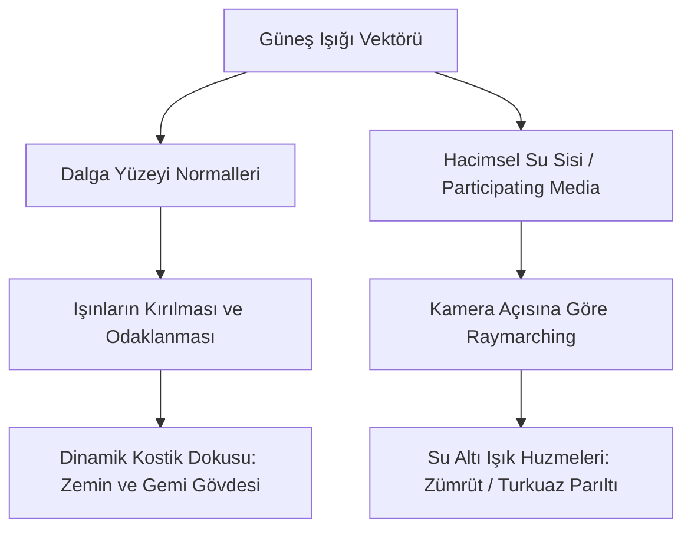

# Sea of Thieves — Gölgelendirme, Aydınlatma ve Optik Sistemler

Sea of Thieves'in görsel başarısı, stilize edilmiş çizgi filmimsi sanat tarzı ile fiziksel tabanlı aydınlatmanın (PBR - Physically Based Rendering) kusursuz birleşimidir. Bu doküman, gölge kaskadlarını, mesafe alanı gölgelerini, su altı ışık huzmelerini ve kostik sistemini ayrıntılandırır.

---

## 1. Kademeli Gölge Haritaları (Cascaded Shadow Maps - CSM)

Geniş okyanusta ve devasa adalarda keskin ve titremeyen gölgeler elde etmek için 4 kademeli CSM mimarisi kullanılır:

```
[KAMERA] ──(Cascade 0: 0-15m)──> [Cascade 1: 15-50m] ──> [Cascade 2: 50-180m] ──> [Cascade 3: 180-600m] ──> [SDF Gölgeleri: 600m+]
          En yüksek çözünürlük      Orta çözünürlük            Geniş alan                    Uzak tepe/ağaçlar         Mesafe Alanı
          (Karakter, güverte)      (Gemi bütünü, yelkenler)   (Ada kıyısı, kayalıklar)       (Uzak adalar)             (Raymarching)
```

### 1.1 Titreme Engelleme (Texel Snapping / Stabilization)
Kamera hareket ettikçe gölge kenarlarının tırtıklanıp titremesini (shadow swimming) önlemek için gölge projeksiyon matrisi, ışık uzayındaki piksel boyutunun tam katlarına kilitlenir:

$$
P_{snapped} = \text{floor}\left(\frac{P_{light}}{TexelSize}\right) \cdot TexelSize
$$

### 1.2 Kaskad Geçiş Yumuşatma (Cascade Blending)
Bir kaskaddan diğerine geçişte ani çözünürlük sıçraması olmaması için kaskad sınırlarında dithered veya doğrusal harmanlama (linear blend) uygulanır.

---

## 2. Uzak Mesafe Gölgeleri (Distance Field Shadows - DFAO)

Güneş ışığının CSM sınırı (yaklaşık 600m) bittiğinde, geleneksel gölge haritaları bellek sınırları nedeniyle yetersiz kalır. Sea of Thieves burada **İşaretli Mesafe Alanları (Signed Distance Fields - SDF)** kullanır:
* Adalardaki her kaya, uçurum ve tepe önceden hesaplanmış birer 3D mesafe alanına sahiptir.
* Güneş ışığı yönünde raymarching yapılarak nesnelerin mesafesine göre yumuşayan (penumbra) fiziksel gölgeler 2-3 kilometre mesafeye kadar neredeyse sıfır bellek maliyetiyle çizilir.
* **Gemi Gövdesi DFAO:** Gemiler kıyılara veya mağaralara girdiğinde gövdenin çevreye yaydığı temas gölgesi (Ambient Occlusion) dinamik SDF ile sağlanır.

---

## 3. Ekran Uzayı Temas Gölgeleri (Contact Shadows & SSAO)

İnce detaylar (geminin halatları, yelken ipleri, güverte tahtalarının aralıkları) CSM çözünürlüğünde kaybolabilir:
* **Contact Shadows:** Ekran uzayında derinlik tamponu (depth buffer) boyunca güneş ışığı yönünde 8-16 adım kısa mesafeli ışın izleme yapılır. Bu, halatların tam temas ettiği noktalarda jilet gibi keskin gölgeler oluşturur.
* **SSAO (Screen Space Ambient Occlusion):** Işık almayan girintilerde, kamaraların köşelerinde ve sandıkların altında yumuşak karartmalar üretir.

---

## 4. Su Altı Aydınlatması, Kostikler ve Işık Huzmeleri (Caustics & God Rays)

Sea of Thieves'te suyun altına daldığınızda veya geminin güvertesinden aşağı baktığınızda büyüleyici bir aydınlatma atmosferi oluşur.



### 4.1 Kostik Haritaları (Underwater Caustics)
Gerçek dünyada dalgaların tepe noktaları lens gibi davranarak güneş ışığını su tabanında parlak çizgiler halinde odaklar.
* Sea of Thieves bunu iki katmanlı, ters yönlerde kayan yüksek frekanslı kostik dokusu ile çözer.
* Kromatik aberasyon (Chromatic Aberration) eklenerek kostik çizgilerinin kenarlarına hafif kırmızı-mavi renk kayması verilir; bu da suyun prizma etkisini simüle eder.
* Kostikler dünya uzayında (world-space) ışık yönünde projekte edilir ve hem deniz tabanına hem de batık gemilerin gövdelerine giydirilir.

### 4.2 Hacimsel Su Altı Işık Huzmeleri (Underwater God Rays)
* Kamera su altındayken okyanus yüzeyine doğru baktığında, dalga tepelerinden sızan ışık demetleri görünür.
* Bu etki, derinliğe bağlı hacimsel sis (Volumetric Water Fog) içinde güneş yönüne doğru raymarching yapılarak elde edilir.
* **Henyey-Greenstein Faz Fonksiyonu:** İleri saçılım (forward scattering) parametresi yüksek tutularak doğrudan güneşe bakıldığında ışık huzmelerinin parlaklığı dramatize edilir.

### 4.3 Dalga Öz-Gölgelendirmesi (Wave Self-Shadowing)
Gün doğumu ve gün batımında güneş ufka çok yakınken, yüksek bir dalga arkasındaki dalga çukurunu gölgede bırakır. Sea of Thieves okyanus gölgelendiricisinde tepe noktası normalinin güneş açısıyla skaler çarpımına ($\vec{N} \cdot \vec{L}$) göre çukurları koyulaştırarak okyanusa olağanüstü bir hacim ve derinlik kazandırır.
