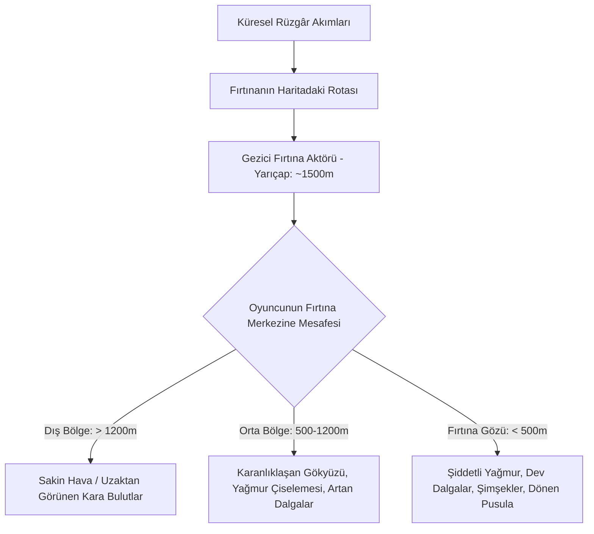

# Sea of Thieves — Hava Durumu, Fırtınalar ve Gün/Gece Ortam Sistemi

Sea of Thieves'te hava durumu statik bir arka plan görseli değildir; harita üzerinde dolaşan, okyanus dalgalarını, rüzgârı, gemi idaresini ve aydınlatmayı doğrudan değiştiren dinamik bir simülasyon katmanıdır.

---

## 1. Gün/Gece Döngüsü (Time of Day & Göksel Sistem)

Sea of Thieves'te 1 oyun günü yaklaşık **24 gerçek dakikaya** karşılık gelir (1 oyun saati = 1 dakika).

```
[GECE - 00:00] ──> [ŞAFAK - 05:30] ──> [ÖĞLE - 12:00] ──> [GÜN BATIMI - 18:30] ──> [ALACAKARANLIK - 20:00]
Soğuk Mavi Işık      Altın / Turuncu      Beyaz / Sarı      Derin Kırmızı / Pembe      Lacivert / Mor Gökyüzü
Yıldızlar & Ay       Ufuk Kırılması       Düşük Sis         Uzun Kaskad Gölgeleri      Fenerler Açılır
```

### 1.1 Güneş ve Ayın Yörüngesi
* Güneş ve ay göksel kürede (celestial sphere) birbirine 180 derece zıt açıyla döner.
* Güneş ufkun altına indiğinde yönlü ışık kaynağı (Directional Light) sorunsuzca aya devredilir.
* Ay ışığı, gece denizinde oyuncuların seyir yapabilmesi için hafif soğuk mavi bir ışık yayar ve su dalgalarının tepelerinde belirgin gümüşi yansımalar (specular highlights) oluşturur.

### 1.2 Atmosferik Renk Eğrileri (Color Curves)
Güneşin zenit açısına ($\theta_{zenith}$) bağlı olarak aşağıdaki parametreler eğriler (curves) üzerinden dinamik güncellenir:
* **Güneş Rengi ve Şiddeti:** Öğlen $110,000 \, Lux$ saf beyaz; gün batımında $15,000 \, Lux$ turuncu-kırmızı.
* **Gökyüzü Saçılımı (Rayleigh & Mie):** Güneş ufka yaklaştıkça ışık daha kalın bir atmosfer tabakasından geçer; mavi dalga boyları saçılır ve geriye sadece kırmızı-turuncu tonlar kalır.
* **Ortam Sisi (Horizon & Height Fog):** Ufuk çizgisi, gökyüzünün en parlak rengiyle harmanlanarak deniz ile göğün yumuşakça birleşmesi sağlanır.

---

## 2. Gezici Fırtına Aktörleri (Autonomous Storm Actors)

Sea of Thieves'teki ünlü fırtına tek bir ekranda beliren global efekt değildir; dünya haritası üzerinde fiziksel olarak hareket eden devasa bir küresel varlıktır.



### 2.1 Uzamsal Etki Çarpanı (Spatial Intensity Interpolation)
Oyuncunun fırtınanın merkezine olan mesafesine göre bir yoğunluk katsayısı ($I_{storm} \in [0, 1]$) hesaplanır:

$$
I_{storm} = \text{saturate}\left(1.0 - \frac{|\vec{P}_{player} - \vec{P}_{storm}|}{R_{storm}}\right)
$$

Bu katsayı arttıkça:
1. **Okyanus Dalgaları Büyür:** Gerstner dalga genliği çarpanı $1.0\times$'dan $2.5\times$'a çıkar. Dalgalar gemiyi aşacak yüksekliğe ulaşır ve dikliği ($Q$) artar.
2. **Görüş Mesafesi Düşer:** Hacimsel sis kalınlaşır; görüş mesafesi 1000 metreden 50 metreye kadar daralır.
3. **Pusula Sapması (Magnetic Anomaly):** Fırtına merkezinde pusula iğnesi çılgınca dönmeye başlar; seyir sadece dalgaların yönüne bakılarak yapılabilir.
4. **Dümen Ağırlığı (Rudder Resistance):** Rüzgâr ve dalga çarpmaları geminin dümenini oyuncunun elinden döndürmeye zorlar (kullanıcının dümeni sürekli düzeltmesi gerekir).
5. **Şimşek Çakmaları:** Rastgele aralıklarla fırtına bulutlarının içinde gök gürültüsü ve ani $100,000 \, Lumen$ noktasal ışıklar parlar. Şimşek doğrudan gemiye isabet ederse yangın başlatır ve delik açar.

---

## 3. Hacimsel Bulutlar (Volumetric Raymarched Clouds)

Sea of Thieves'in gökyüzü düz bir gökyüzü kubbesi (skybox) değildir; 3 boyutlu hacimsel bir simülasyondur.

### 3.1 3D Perlin-Worley Gürültüsü (Noise Textures)
Bulutlar, iki katmanlı 3D doku kullanılarak ışın yürütme (raymarching) yöntemiyle çizilir:
* **Temel Şekil (Low-Frequency Worley):** Devasa kümübülüt kümelerinin ana gövdesini oluşturur.
* **Kenar Detayları (High-Frequency Curl/Erosion):** Bulutların kenarlarındaki pamuksu, rüzgârla savrulan lifli yapıları oyar.

### 3.2 İki Katmanlı Işık Saçılımı (Dual Scattering & Silver Lining)
* **Gümüş Astar (Silver Lining):** Güneş bulutun arkasındayken, bulut kenarlarındaki su damlacıkları ışığı ileriye doğru odaklar (Henyey-Greenstein $g \approx 0.8$). Bulutun kenarları altın sarısı bir çizgi halinde parlar.
* **Koyu Alt Karın (Dark Underside):** Fırtına bulutlarında optik kalınlık ($\tau$) çok yüksek olduğu için güneş ışığı bulutun içine girdikçe emilir; bulutun tabanı siyaha yakın kurşuni bir renk alır.

---

## 4. Yağmur ve Yüzey Islaklık Gölgelendiricileri (Wetness Shading)

Fırtına alanına girildiğinde çevrenin malzemeleri fiziksel olarak değişir:

1. **Malzeme Islaklığı (PBR Roughness Değişimi):**
   * Ahşap güvertelerin, kayaların ve yelkenlerin pürüzlülük (roughness) değeri $0.8$'den $0.05$'e düşer.
   * Yüzeyler ayna gibi parlamaya başlar ve gökyüzünü yansıtır.
   * Gözeneklilik (porosity) kararması uygulanarak ıslanan ahşap ve kumaşların albedo renkleri $\%30$ oranında koyulaştırılır.
2. **Ekran Damlacıkları (Screen Droplets & Runoff):**
   * Kameranın camında aşağı doğru süzülen su damlaları normal haritası kaydırması ile simüle edilir.
   * Damlaların arkasındaki sahne kırılmaya (refraction) uğrayarak bulanıklaşır.
3. **Güverte Su Birikintisi (Puddles):**
   * Güverte tahtalarının eğimine göre oyuklarda küçük su birikintileri oluşur; bu birikintilerin üstünde yağmur damlacıklarının oluşturduğu halka dalgacıkları (ripple normal loops) oynatılır.
