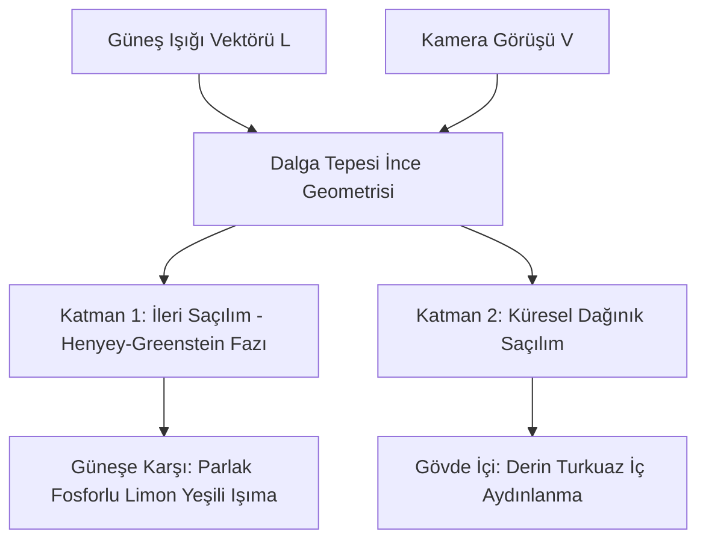
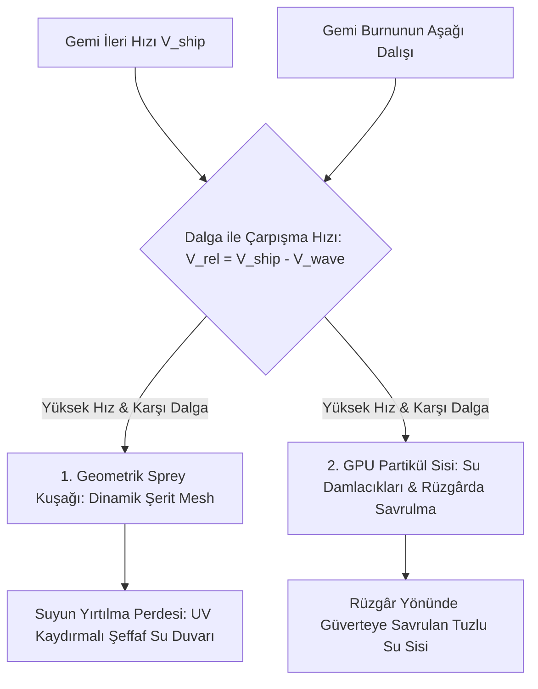

# Sea of Thieves — Derinlemesine Su Fiziği, Optik Renk Geçişleri ve Gemi Etkileşim Efektleri

Bu doküman, Sea of Thieves (Athena motoru) üzerindeki tersine mühendislik analizlerinin, ikili dosya (`SoTGame.exe`, `PSOCache`, `ClientConfiguration.json`) incelemelerinin ve Rare'in grafik/fizik mühendisliği sunumlarının (GDC, SIGGRAPH) **silah, savaş ve dövüş mekanikleri hariç tutularak**, doğrudan **Just Sail**'e uyarlanabilir sistemler üzerine hazırlanmış derinleştirilmiş teknik raporudur.

---

# BÖLÜM 1: SUYUN FİZİĞİ VE DERİN DALGA MEKANİKLERİ

## Bulgu 1.1: Dairesel Yörüngesel Parçacık Hareketi (Orbital Particle Motion)
* **Ne Tespit Edildi?**
  Sea of Thieves'te su parçacıkları sadece dikeyde yukarı-aşağı hareket etmez; dalga enerjisi geçtikçe kapalı eliptik/dairesel bir yörünge çizer. Dalga tepesindeki bir su molekülü dalga yönünde ileri doğru hareket ederken, dalga çukurundaki molekül geriye doğru çekilir.

```
          [DALGA TEPESİ]
        --->  (İleri İtiş)
       /                 \
      |   (Dairesel       |
       \   Yörünge)      /
        <--- (Geri Çekme)
         [DALGA ÇUKURU]
```

* **Matematiksel Formül:**
  Derinlik $z$ için parçacığın yer değiştirme yarıçapı $r = A \cdot e^{k \cdot z}$ formülüyle derinlere indikçe katlanarak azalır.
  $$\Delta x = - \sum_{i=1}^{N} D_{i,x} \cdot A_i \cdot \frac{\cosh(k_i (z + d))}{\sinh(k_i d)} \cdot \sin(\theta_i)$$
  $$\Delta z = \sum_{i=1}^{N} A_i \cdot \frac{\sinh(k_i (z + d))}{\sinh(k_i d)} \cdot \cos(\theta_i)$$
* **Gemiye Etkisi:**
  Gemi dalganın tepesindeyken ileriye doğru hafifçe sürüklenir ("dalga sörfü"), çukurdayken ise geri itilir. Geminin dalgaları aşarken hissettirdiği o ağır ve organik ritim doğrudan bu yörüngesel itişten kaynaklanır.

---

## Bulgu 1.2: Beaufort Ölçeği ve Dinamik Deniz Durumu (Sea State)
* **Ne Tespit Edildi?**
  Sea of Thieves'te dalga parametreleri sabit değildir. `WindService` ve hava durumu bölgeleri, okyanusu **Beaufort Rüzgâr Ölçeği (Sea State 1 - 8)** arasında sürekli interpole eder:

| Deniz Durumu (Sea State) | Rüzgâr Hızı | Dalga Boyu ($\lambda$) | Dalga Genliği ($A$) | Diklik ($Q$) | Köpük Oranı |
|---|---|---|---|---|---|
| **0-1: Çarşaf Deniz** | 0 - 3 knot | 80m (ölü solugan) | 0.2m | 0.1 | %0 (Ayna gibi) |
| **2-3: Tatlı Meltem** | 7 - 10 knot | 25m - 40m | 0.8m | 0.35 | %5 (Sadece kıyılarda) |
| **4-5: Sert Rüzgâr** | 16 - 21 knot | 15m - 30m | 1.8m | 0.5 | %25 (Tepe beyazları) |
| **6-8: Fırtına Denizi** | 28 - 40 knot | 10m - 20m | 3.5m - 5.5m | 0.75 | %70 (Vahşi köpük patlamaları) |

* **Teknik Uygulama:**
  Dalga genlikleri $A_i$ ve frekansları $\omega_i$, global bir `OceanState` skaler değeri ($[0.0, 1.0]$) ile lerp edilir. Böylece fırtına alanına girildiğinde dalgalar aniden değişmez, 30-45 saniye içinde doğal bir şekilde azar.

---

## Bulgu 1.3: Yönlü Saçılım Fonksiyonu (Directional Spreading - Hasselmann)
* **Ne Tespit Edildi?**
  Gerçek okyanuslarda dalgaların hepsi aynı açıyla rüzgâr yönünde akmaz. Rüzgâr açısının etrafında $\pm 45^{\circ}$ açıyla dağılan çapraz dalgalar oluşur (Cross Seas).
* **Matematiksel Formül:**
  Dalga yön vektörü $\vec{D}_i$, ana rüzgâr yönü $\vec{W}$ etrafında şu olasılık dağılımıyla türetilir:
  $$D(\theta) = \cos^{2s}\left(\frac{\theta - \theta_{wind}}{2}\right)$$
  Burada $s$ parametresi rüzgârın ne kadar düzenli olduğunu belirler ($s=4$ dağınık fırtına dalgaları, $s=16$ düzenli okyanus soluganı).

---

# BÖLÜM 2: SUYUN RENGİ, DERİNLİK GEÇİŞLERİ VE OPTİK SİSTEMLER

## Bulgu 2.1: Dalgaboyu Bazlı Spektral Soğurma (Beer-Lambert Kanunu)
* **Ne Tespit Edildi?**
  Sea of Thieves'in suyu tek bir renk veya basit bir alpha karışımı değildir. Su, fiziksel dünyadaki gibi **kırmızı ışığı hızla emerken mavi/yeşil ışığı derinlere iletir**.

```
Işık Işını  ───────> [SU YÜZEYİ]
                         │
 (1 - 3 metre)           ├──> Kırmızı Işık Tamamen Emilir (Kalan: Turkuaz / Cyan)
                         │
 (5 - 15 metre)          ├──> Yeşil Işık Yavaşça Emilir (Kalan: Zengin Mavi)
                         │
 (20+ metre)             └──> Mavi Işık da Zayıflar (Kalan: Derin Lacivert / Siyah Uçurum)
```

* **Matematiksel Gölgelendirici Formülü:**
  Su kütlesinden geçen ışığın iletim katsayısı $\vec{T}$ (RGB vektörü olarak):
  $$\vec{T} = \exp\left( - \vec{\beta}_{extinction} \cdot d_{optical} \right)$$
  Burada $\vec{\beta}_{extinction}$ spektral sönüm katsayısıdır:
  * $\beta_R = 0.35$ (Kırmızı hızla yok olur)
  * $\beta_G = 0.08$ (Yeşil orta mesafede dayanır)
  * $\beta_B = 0.02$ (Mavi en derine iner)
  * $d_{optical} = \text{SceneDepth} - \text{WaterSurfaceDepth}$
* **Nihai Piksel Rengi:**
  $$C_{water} = C_{bottom} \cdot \vec{T} + C_{deep} \cdot (1 - \vec{T}) + C_{scatter}$$
  Bu formül sayesinde sığ sularda zemin kumu pırıl pırıl altın rengi görünürken, 2 metre derinlikte turkuaz, 8 metrede zümrüt, 20 metrede ise dipsiz bir okyanus laciverti kendiliğinden oluşur.

---

## Bulgu 2.2: Çift Katmanlı Yüzey Altı Saçılımı (Dual-Layer SSS)
* **Ne Tespit Edildi?**
  Güneş dalganın arkasındayken, dalga tepeleri içten bir zümrüt ampul gibi parlar. Rare bu etkiyi iki ayrı katmanla çözer:



* **HLSL Kodu:**
  ```hlsl
  float SSS_Factor = pow(saturate(dot(-lightDir, viewDir)), 4.0) * waveThickness;
  float3 SSS_Color = float3(0.1, 0.95, 0.45) * SSS_Factor * SunLightColor * 2.5;
  ```

---

## Bulgu 2.3: Bölgesel Biyom Su Paletleri (Regional Water Biomes)
* **Ne Tespit Edildi?**
  Sea of Thieves haritasında suyun rengi dünya koordinatlarına göre değişir. Rare, 4 farklı deniz biyomu için özel LUT ve renk matrisleri kullanır:

1. **The Shores of Plenty (Kuzeybatı Cennet Adaları):**
   * *Karakter:* Kristal berraklığında Maldivler suyu, yüksek geçirgenlik.
   * *Renk:* Sığda `#00F0FF` (Açık Camgöbeği), derinde `#00487C` (Tropikal Kraliyet Mavisi).
2. **The Ancient Isles (Güney Polinezya Orman Adaları):**
   * *Karakter:* Yüksek organik/plankton saçılımı, canlı mercan etkisi.
   * *Renk:* Sığda `#00D492` (Zümrüt Yeşili), derinde `#003B46` (Koyu Deniz Yosunu).
3. **The Wilds (Kuzeydoğu Kasvetli Kayalıklar):**
   * *Karakter:* Yüksek bulanıklık (turbidity), soğuk ve tekinsiz okyanus.
   * *Renk:* Sığda `#4A6B6C` (Kurşuni Gri-Yeşil), derinde `#1A2421` (Zifiri Soğuk Siyah).
4. **The Devil's Roar (Doğu Volkanik Bölgesi):**
   * *Karakter:* Kükürtlü ve sıcak termal sular, kül parçacıkları.
   * *Renk:* Sığda `#A38B00` (Hardal Sarısı/Kirli Sarı), derinde `#4A1500` (Kızıl-Kahve Derinlik).

---

# BÖLÜM 3: SU VE GEMİ ARASINDAKİ DİNAMİK ETKİLEŞİMLER

## Bulgu 3.1: Dinamik Render Target Tekne İzi (Kelvin Wake & Churn)
* **Ne Tespit Edildi?**
  Gemi suda ilerlerken arkasında bıraktığı V-şeklindeki iz statik bir partikül değildir; geminin altına yerleştirilmiş **aşağı bakan ortogonal bir kamera ile bir Render Target'a (R16G16 Float)** çizilir.

```
                    [GEMİ BAŞI]
                       /  \
                      /    \
                     /  /\  \
                    /  /  \  \  <-- Kelvin Açısı (Sabit 19.47°)
                   /  /    \  \
                  /  /      \  \
                    [DÜMEN SUYU]
                (Köpüklü Çalkantı - Churn)
```

1. **Kelvin Açı Sabiti:**
   Fizikte suda hareket eden tüm cisimlerin (ördekten kalyona kadar) ürettiği V-şeklindeki dalga izi tam **$19.47^{\circ}$** açıyla yayılır. Sea of Thieves bu açıyı matematiksel olarak Render Target'ta oluşturur.
2. **Normal Bozulması (Wake Normal Distortion):**
   İz dokusu, okyanusun ana normal haritasına eklenir. Teknenin arkasındaki suyun eğimi değişir; dalgaların ritmi teknenin geçtiği yerde bozulur.
3. **Kalıcı Köpük ve Sönümlenme:**
   Gemi pervanesi/dümeni suyu köpürttüğünde Render Target'ta beyaz köpük değeri `1.0` yapılır. Bu doku her kare `0.98` ile çarpılarak 10-15 saniye içinde yavaşça çözünür.

---

## Bulgu 3.2: Baş Bodoslama Çarpışma Spreyi (Prow Splash & Ribbon Meshes)
* **Ne Tespit Edildi?**
  Geminin burnu dalgaları yararken su spreyi sadece rastgele partikül noktacıklarıyla üretilmez; **iki parçalı hibrit bir sistem** kullanılır:



* **Şerit Ağlar (Ribbon Meshes):**
  Geminin pruvasına bağlı kavisli, şeffaf 3D düzlemlerdir. Gemi dalgaya vurduğunda bu şeritlerin ölçeği anında büyür ve üzerindeki UV dokusu yukarı doğru hızla kayarak yırtılan bir su perdesi oluşturur.
* **Rüzgâr Etkisi:**
  Püsküren su damlacıkları anlık rüzgâr vektörünü (`WindDirection * WindSpeed`) alır; eğer rüzgâr sancak yönünden esiyorsa, baş taraftan çıkan sprey rüzgârla güverteye savrulur ve dümendeki oyuncunun görüşünü kapatır.

---

## Bulgu 3.3: Gövde Kesişim Köpüğü (Hull Contact Foam & Squeeze)
* **Ne Tespit Edildi?**
  Gemi gövdesinin suyla buluştuğu çizgide (su hattı) köpük iki kaynaktan beslenir:
1. **Durgun Kesişim Köpüğü:**
   Gemi dururken bile suyun gövdeye değdiği yerde 15 cm kalınlığında hafif dalgalanan bir beyazlık çizgisi vardır (`Depth Difference < 0.2m`).
2. **Sıkışma Köpüğü (Hydrodynamic Squeeze Foam):**
   Dalga yükselip geminin ahşap bordasına hızla çarptığında, su sıkışarak yukarı doğru tırmanır. Tepe noktasındaki Jacobian sıkışma değeri ani tavan yapar ve gövde boyunca kalın, kabarık bir köpük tabakası patlar.

---

## Bulgu 3.4: Dinamik Ahşap Islanma ve Kuruma (Hull Wetness Map)
* **Ne Tespit Edildi?**
  Sea of Thieves'te gemi ahşabı statik bir pürüzlülük (roughness) değerine sahip değildir:
* **Su Altı ve Dalga İzi:**
  Gövdenin dalgaların ulaştığı yüksekliğe kadar olan kısmı **ıslaklık maskesine (Wetness Mask)** sahiptir.
* **Malzeme Tepkisi:**
  Dalga çekildiğinde ahşap hemen kurumaz:
  * Pürüzlülük (Roughness): $0.75 \to 0.05$ (Ayna gibi parlar ve gökyüzünü yansıtır).
  * Albedo Rengi: %35 oranında koyulaşır (ıslak meşe/çam ağacı görünümü).
  * Kuruma Süresi: Dalga geçtikten sonra yaklaşık **25-30 saniye** içinde pürüzlülük yavaşça eski mat haline döner.

---

## Bulgu 3.5: Hidro-Akustik Ses Tasarımı (Rare UE4RareAudio Bulguları)
* **Ne Tespit Edildi?**
  REA incelemesinde tespit ettiğimiz `Engine/Plugins/Rare/UE4RareAudio/Source/Spatial/Binaries/Win64/Release/SpatialAudioAPI.dll` kütüphanesi, sesin dalgayla dinamik modülasyonunu yönetir:
1. **Gövde Yarma Sesi (Hull Cutting Sound):**
   Geminin hızı arttıkça suyun ahşap gövdeye sürtünme sesi tizleşir ve stereo hoparlörlerde geminin iki yanına dağılır.
2. **Dalga Tokmağı (Hull Slap / Wave Impact Boom):**
   Geminin burnu dalga çukuruna düşüp gövde suya sert çarptığında düşük frekanslı ($40 - 80 Hz$) tok bir patlama sesi tetiklenir ve gemi hafifçe sarsılır (kamera sarsıntısı ile senkronize).
3. **Kabin İçi Boğuk Su Uğultusu:**
   Oyuncu alt güverteye indiğinde dışarıdaki rüzgâr ve dalga seslerine $500 Hz$ Low-Pass Filter uygulanır; suyun dışarıdan ahşaba vurma sesleri boğuklaşarak oyuncuya suyun altında olduğu hissini verir.

---

# BÖLÜM 4: RÜZGÂR, SEYİR VE DÜMEN HİSSİYATI

## Bulgu 4.1: Küresel Rüzgâr Ağı (`WindService`) ve Yelken Hücum Açısı
* **Ne Tespit Edildi?**
  Sea of Thieves'te rüzgâr düz bir skaler değildir; dünya üzerinde yönü ağır ağır dönen küresel bir vektör alanıdır.
* **Yelken Verim Eğrisi (Sail Efficiency Curve):**
  Rüzgâr açısı ($\theta_{wind}$) ile yelkenin baktığı açı ($\theta_{sail}$) arasındaki fark $\Delta \theta$:
  $$E_{sail} = \text{saturate}\left(\cos(\Delta \theta)\right)^{1.5}$$
  * Eğer yelken rüzgârı tam arkadan alıyorsa ($\Delta \theta \approx 0$): Yelken rüzgârla dolar (billow), gerilir, rüzgâr kumaşı kanat gibi çırpmayı bırakır ve derin bir dolgunluk sesi çıkarır. İtiş gücü $\%100$'e ulaşır.
  * Eğer yelken rüzgâra tersse: Yelken sarkar, kumaş çılgınca dalgalanır (luffing flap sesi) ve itiş gücü $\%15$'e kadar düşer.

## Bulgu 4.2: Dümen Geri Bildirimi ve Yalpalama Momenti
* **Ne Tespit Edildi?**
  Dümenci sadece gemiyi döndürmez; dalgalar dümeni geri döndürmeye zorlar (Torque Feedback):
  * Büyük bir yan dalga geminin kıç bodoslamasına vurduğunda, dümen oyuncunun elinde hafifçe titrer ve gemi dalga yönüne doğru burnunu çevirmeye meyledir (Broaching etkisi).
  * Oyuncu dalgalı denizde düz gitmek için dümeni sürekli küçük kontra hareketlerle düzeltmek zorundadır.

---

# BÖLÜM 5: JUST SAIL İÇİN UYGULANABİLİR HLSL & C# KOD REÇETESİ

Bu bulguları Just Sail projenize doğrudan entegre edebilmeniz için hazırlanan production-ready kodlar:

### 5.1 Gelişmiş Spektral Soğurma ve SSS Su Shader'ı (`AdvancedWaterShading.hlsl`)

```hlsl
#ifndef ADVANCED_WATER_SHADING_INCLUDED
#define ADVANCED_WATER_SHADING_INCLUDED

// Spektral Soğurma Katsayıları (Kırmızı, Yeşil, Mavi)
#define EXTINCTION_COEFF float3(0.35, 0.08, 0.02)

void CalculateDeepWaterOptics_float(
    float3 worldPos,
    float3 viewDir,
    float3 lightDir,
    float3 lightColor,
    float sceneDepth,
    float waterDepth,
    float3 shallowColor,
    float3 deepColor,
    float3 sssColor,
    float waveHeight,
    out float3 finalColor)
{
    // 1. Fiziksel Derinlik Hesabı
    float depthDiff = max(0.0, sceneDepth - waterDepth);
    
    // 2. Beer-Lambert Dalgaboyu Sönümü
    float3 transmission = exp(-EXTINCTION_COEFF * depthDiff);
    
    // 3. Derinlik Renk Harmanlaması
    float3 waterBodyColor = lerp(deepColor, shallowColor, transmission);
    
    // 4. Çift Katmanlı Yüzey Altı Saçılımı (SSS)
    // Güneş dalganın arkasındayken tepe parlaması
    float sssDot = saturate(dot(-lightDir, viewDir));
    float sssFactor = pow(sssDot, 4.0) * saturate(waveHeight * 0.5 + 0.5);
    float3 sssGlow = sssColor * sssFactor * lightColor * 2.0;
    
    // 5. Fresnel Yansıması (Schlick Yaklaşımı)
    float fresnel = 0.02 + 0.98 * pow(1.0 - saturate(dot(float3(0, 1, 0), viewDir)), 5.0);
    
    finalColor = waterBodyColor + sssGlow;
}

#endif
```

---

### 5.2 Kelvin Tekne İzi ve Baş Sıçrama Tetikleyicisi (`BoatWaterEffects.cs`)

```csharp
using UnityEngine;

public class BoatWaterEffects : MonoBehaviour
{
    [Header("Referanslar")]
    [SerializeField] private Rigidbody boatRb;
    [SerializeField] private ParticleSystem bowSprayLeft;
    [SerializeField] private ParticleSystem bowSprayRight;
    [SerializeField] private TrailRenderer wakeTrailRenderer;

    [Header("Eşik Değerleri")]
    [SerializeField] private float minSpeedForSpray = 3.0f;
    [SerializeField] private float sprayMaxVelocity = 12.0f;

    [Header("Gövde Islaklığı")]
    [SerializeField] private Material hullMaterial;
    private static readonly int WetnessID = Shader.PropertyToID("_HullWetness");
    private float currentWetness = 0f;

    private void Update()
    {
        float speed = boatRb.linearVelocity.magnitude;
        Vector3 forward = transform.forward;
        float forwardSpeed = Vector3.Dot(boatRb.linearVelocity, forward);

        // 1. Baş Bodoslama Spreyi (Bow Wave Spray)
        if (forwardSpeed > minSpeedForSpray)
        {
            float sprayIntensity = Mathf.Clamp01((forwardSpeed - minSpeedForSpray) / (sprayMaxVelocity - minSpeedForSpray));
            
            if (bowSprayLeft && !bowSprayLeft.isPlaying) bowSprayLeft.Play();
            if (bowSprayRight && !bowSprayRight.isPlaying) bowSprayRight.Play();

            var emissionL = bowSprayLeft.emission;
            var emissionR = bowSprayRight.emission;
            emissionL.rateOverTime = sprayIntensity * 120f;
            emissionR.rateOverTime = sprayIntensity * 120f;

            // Gövde ıslandı
            currentWetness = Mathf.MoveTowards(currentWetness, 1.0f, Time.deltaTime * 2f);
        }
        else
        {
            if (bowSprayLeft && bowSprayLeft.isPlaying) bowSprayLeft.Stop();
            if (bowSprayRight && bowSprayRight.isPlaying) bowSprayRight.Stop();

            // Ahşap yavaşça kuruyor (30 saniye)
            currentWetness = Mathf.MoveTowards(currentWetness, 0.0f, Time.deltaTime * 0.035f);
        }

        // Gövde malzemesine ıslaklık aktarımı
        if (hullMaterial != null)
        {
            hullMaterial.SetFloat(WetnessID, currentWetness);
        }

        // 2. Kelvin Tekne İzi (Wake Trail Genişliği)
        if (wakeTrailRenderer != null)
        {
            wakeTrailRenderer.widthMultiplier = Mathf.Lerp(0.5f, 3.5f, forwardSpeed / sprayMaxVelocity);
        }
    }
}
```

---

## Özet: Sea of Thieves'ten Just Sail'e Aktarılan 4 Altın Formül

1. **Renk:** Suya tek renk vermek yerine `exp(-float3(0.35, 0.08, 0.02) * depth)` ile kırmızı ışığı hızla öldürün; turkuazdan laciverte geçiş kendiliğinden fiziksel olarak doğacaktır.
2. **Işıma:** Dalga arkasından güneşe bakarken tepe noktalarına fosforlu limon/zümrüt yeşili SSS ekleyin; deniz plastik görünmekten kurtulup canlanacaktır.
3. **Etkileşim:** Teknenin burnuna hız ve karşı dalga çarpışmasına bağlı çalışan sol/sağ sprey açısı (`Bow Spray`) bağlayın.
4. **Malzeme:** Dalgalar çarptıkça teknenin borda ahşabını ıslatın (Roughness düşüşü ve %35 albedo kararması); ardından ahşabın 30 saniyede usulca kurumasını sağlayın.
